# Onboarding redesign — landing, demo and sign-in

A redesign of the first-visit experience: the hero, the interactive demo, the
end of the demo, pricing, and the sign-up / sign-in screens. It came out of an
onboarding audit of the staging app (2026-10-09) that asked one question: can
someone who has never heard of Polishline understand it, try it, and sign up
without getting stuck?

`index.html` is one self-contained file (styles and scripts inline, Google
Fonts the only external request). Open it in a browser. It is a prototype of
the proposed UI, not a build of the app: forms validate in the browser only and
nothing is sent anywhere.

The existing landing page at the repo root (`/index.html`) is untouched.

## What changed, and why

| # | Area | Problem found in the audit | Change |
|---|------|----------------------------|--------|
| 1 | Hero | The first screen never said who the product is for or what kind of tool it is. "Translate in context" reads like machine translation. | Eyebrow *AI translation workspace · for literary and essay translators*. Headline *Translate it yourself. Let AI help you think.* Primary button *Try the interactive demo* with *No sign-up needed*; *Start free* as the secondary button. |
| 2 | Header | *Try it now* went straight to a sign-in screen; sign-up was a small link. | Two actions: **Start free** (sign-up) and **Sign in**. |
| 3 | Demo: next step | First-time visitors could not tell which control to press next, especially after step 3, when it moves from the right panel to the left. | After 1.2 s of hesitation, two gold rings ripple out from the next control. Hover or keyboard focus switches it off; with reduced motion it becomes a fixed gold ring. A step counter (*Explore · Step 4 of 7*) sits above the demo. |
| 4 | Demo: tab bar | After the first click the tab bar slid under the fixed header. | Scrolls so the tab bar always stays visible. |
| 5 | Demo: end | Finishing the demo led back to the start; there was no way to sign up at the moment of highest interest. | An end card, *Now try it on your own text.*, with **Start free** (same ripple cue) and **Replay the demo**, plus a one-line recap of each tab. |
| 6 | Pricing | Cards ran Free → Pro → Light, and every button led back to the demo. | Free → Light → Pro. Only Free is a filled button, since free sign-up is the one thing people can do today; paid plans say *No payment today*. |
| 7 | Sign-up / sign-in | Looked like a different product (other colours and fonts). The error *"Those details could not open your desk."* did not say what went wrong and stayed on screen after switching to sign-up. | Same type and colours as the landing page. **Continue with Google** is the main button, email as the secondary path. Separate `#signup` and `#signin` screens. Errors name the cause and the next step, e.g. *That password isn't right. Try again or reset your password.* |
| 8 | Sharing and loading | No Open Graph or Twitter tags; a blank page without JavaScript; demo progress was lost on refresh. | OG and Twitter tags, a `noscript` message, and demo progress kept in `sessionStorage`. |
| 9 | Mobile | Key demo hints were 8–9 px on a 390 px screen. | Body text at least 14 px and tap targets at least 44 px at 390 px. |

Kept as they are: the page's sections and copy (outside the areas above), the
demo's steps and wording, dark mode, and the FAQ. The only FAQ edit replaces
*Use Try it now…* with *Start free*, because that button no longer exists.

## Before and after

| | Before | After |
|---|---|---|
| Hero (desktop) | 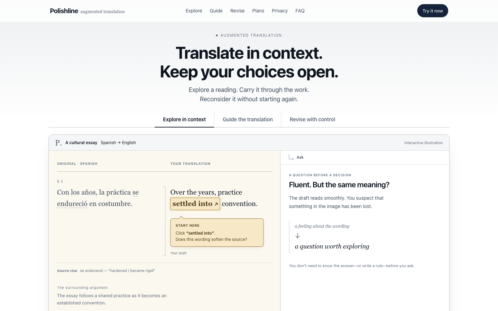 | 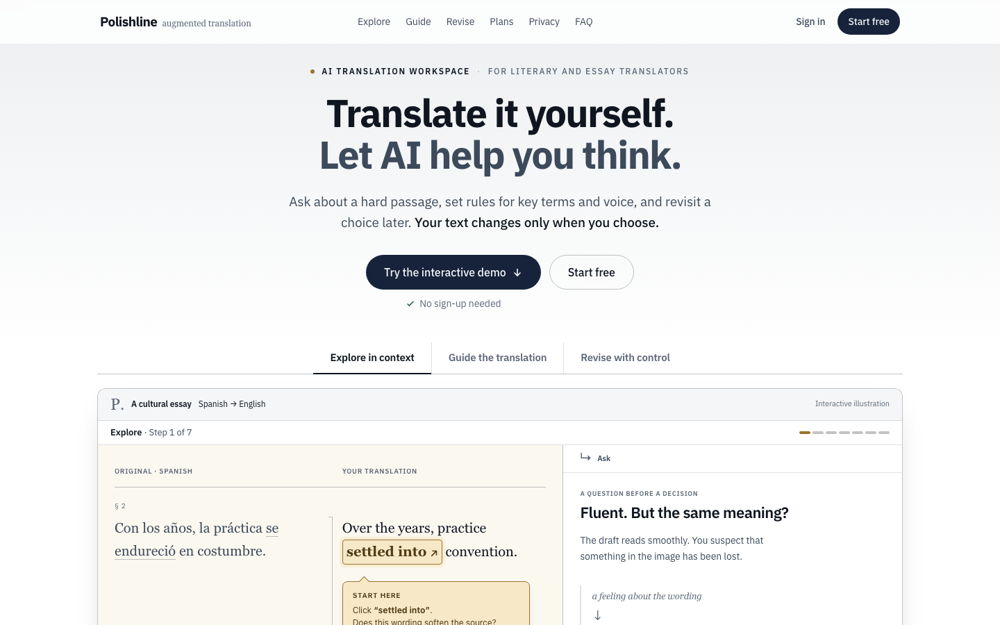 |
| Hero (mobile) | 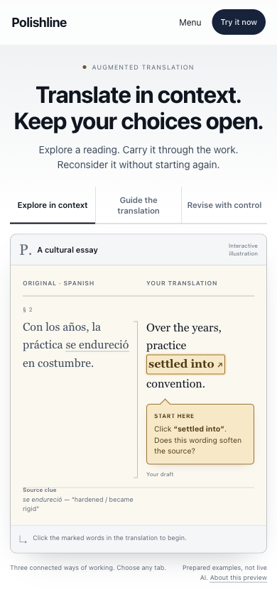 | 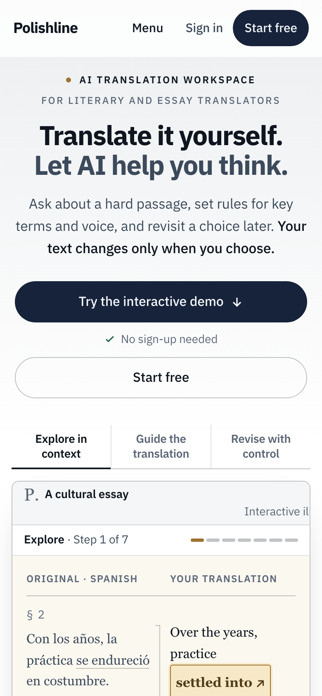 |
| Demo step | 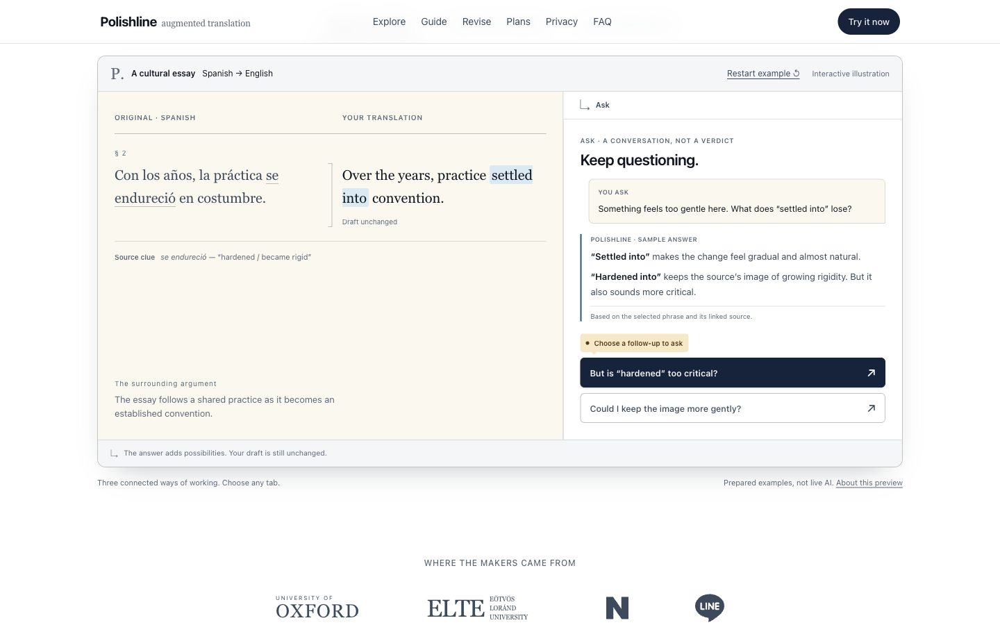 | 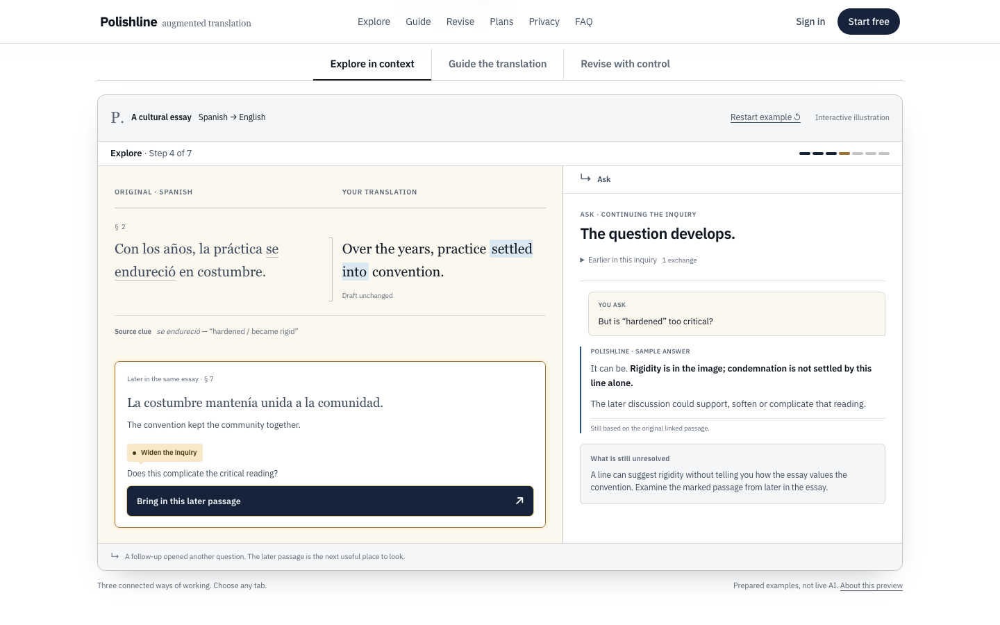 |
| Next-step cue | — | 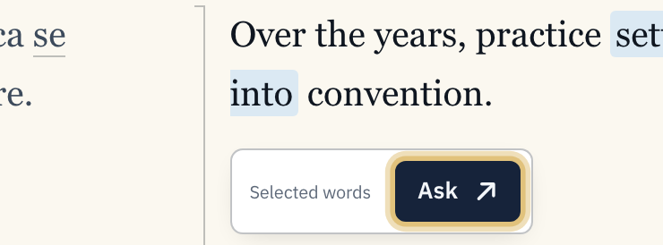 |
| Demo end | 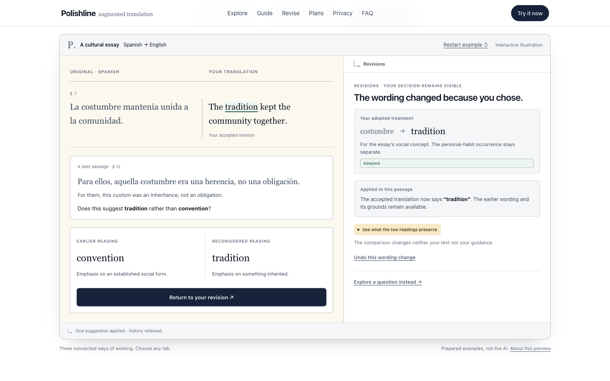 | 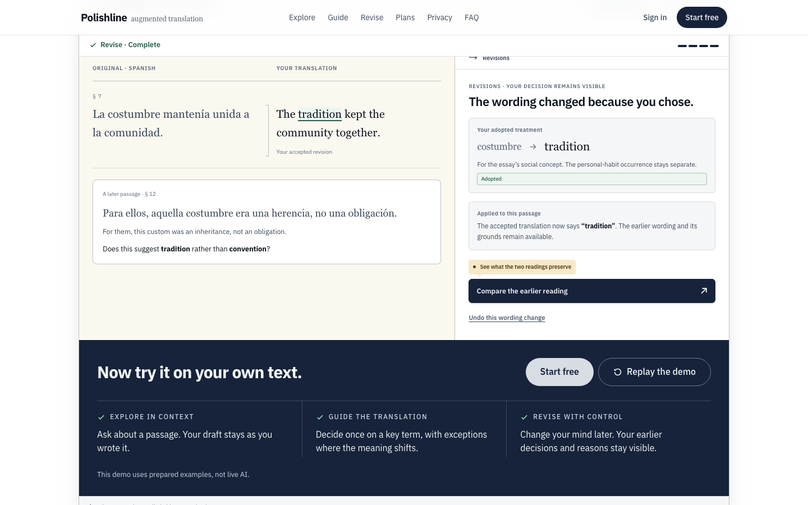 |
| Start free cue | — | 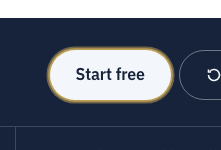 |
| Pricing | 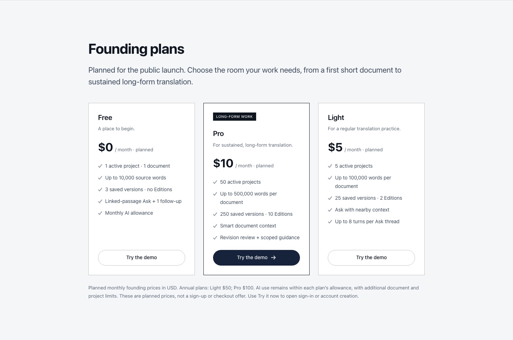 | 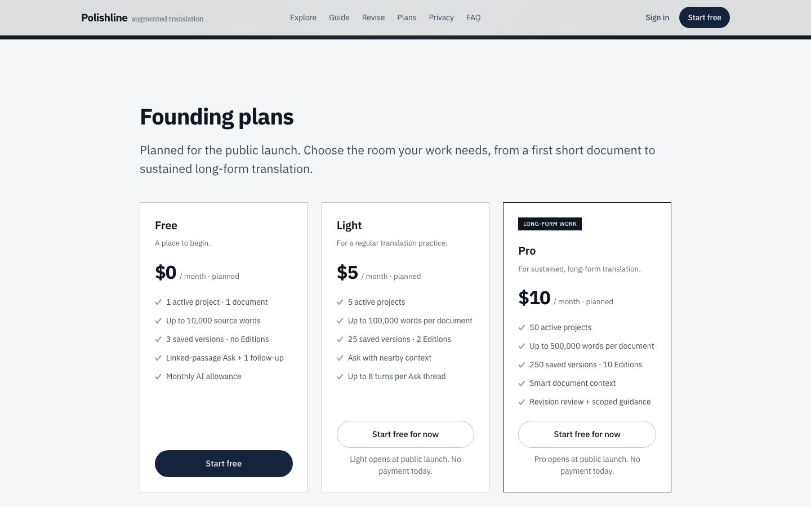 |
| Sign-in | 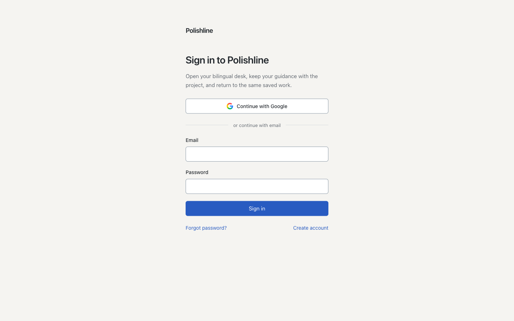 | 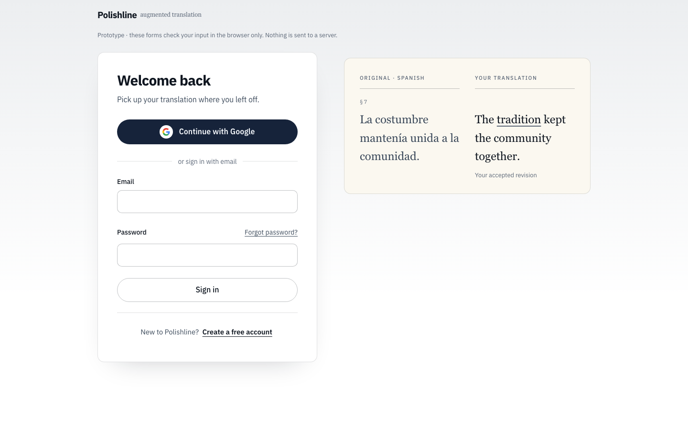 |
| Sign-in error | 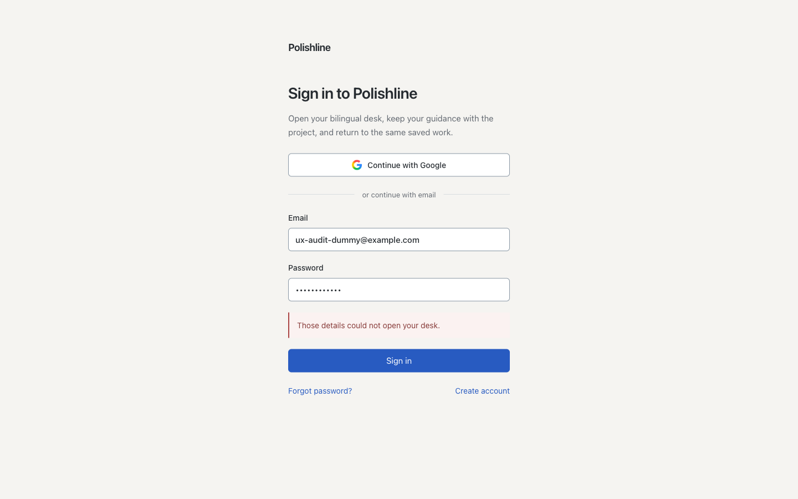 | 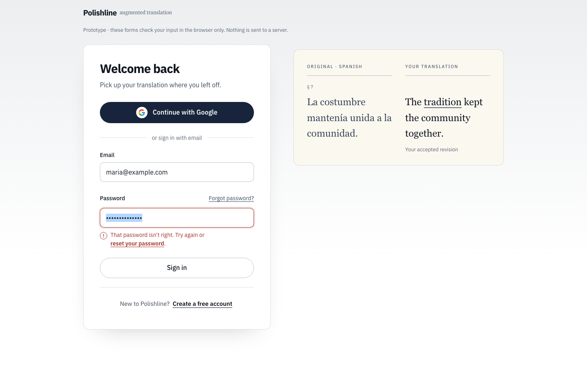 |

More: `after-05-signup-desktop.png`, `after-05-signin-mobile.png`,
`after-03-demo-end-mobile.png`.

## Checked

At 1440 px and 390 px, in light and dark mode, using Playwright:

- the demo can be completed with a mouse, by touch and with the keyboard alone
- Start free and Sign in reach their screens, and the error states show
- no console errors and no horizontal scrolling

Not checked: real devices, a screen reader read-through, and the live Google
sign-in flow (the button only shows a notice here).

## Still to decide before this goes into the app

- Password rule. The prototype uses a minimum of 8 characters as a placeholder.
- Annual prices (Light $50 / Pro $100). The new pricing footnote dropped them; put them back or not.
- `og:image`, `og:url` and canonical need the production URL.
- Terms and privacy links on the sign-up screen. Left out until those pages exist.
- Whether sign-in errors name the cause or use one combined message. Naming the cause tells anyone whether an email has an account.
- The Explore tab still has 7 steps. Shortening it would bring the first real change in the draft forward, but no concrete cut was proposed, so it was left alone.
